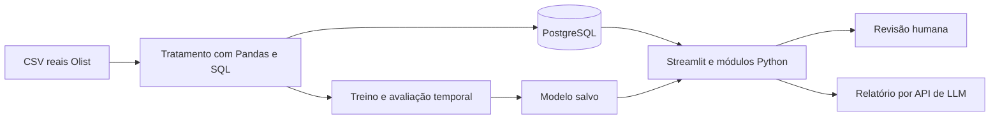

# Desenvolvimento do EntregaCerta AI

Atualizado em 05/11/2026. Este é o documento central de acompanhamento; o README explica a estrutura e a preparação.

## Problema e dados

Priorizar pedidos que merecem acompanhamento humano por risco de entrega após o dia prometido. A previsão será feita com informações disponíveis na aprovação; a demonstração será uma reprodução histórica.

Fonte: [Brazilian E-Commerce Public Dataset by Olist](https://www.kaggle.com/datasets/olistbr/brazilian-ecommerce), registros reais e anonimizados do comércio eletrônico brasileiro de 2016 a 2018. Licença publicada: CC BY-NC-SA 4.0; preservar atribuição e condições. O recebimento e o hash do ZIP estão em `recebimento_dataset.txt`. Os nove originais estão em `Dados/Brazilian Logistic/`; a consolidação está em `Dados/pedidos_consolidados.csv`.

Unidade: um pedido, agregando seus itens. Positivo: dia da entrega efetiva posterior ao dia prometido. Entrega no mesmo dia é pontual. Cancelados e casos sem desfecho não são rotulados automaticamente como pontuais; o estudo inicial se limita aos entregues elegíveis.

Usar preço/frete informado, composição do pedido, categoria, peso/dimensões, UFs e prazo/calendário quando adequados. Entrega efetiva, passagem à transportadora, status final e avaliações posteriores ficam fora da entrada do modelo. A fonte não tem versões históricas: a disponibilidade dos cadastros e da promessa na aprovação é uma hipótese a documentar.

## Arquitetura prevista



Backend em módulos Python e interface Streamlit na mesma aplicação. PyTorch entra em uma rede pequena para comparação; Scikit-learn cobre pré-processamento, referências e modelos clássicos. O modelo final será escolhido pela validação, não pela complexidade da ferramenta.

O BPMN documental já existente foi preservado em `processo.bpmn`, com prévia em `processo.png`. Ele representa o fluxo planejado; será atualizado conforme a implementação. A infraestrutura Terraform ficará para a entrega final.

## Roadmap e modo de trabalho

| Etapa | Trabalho e entrega | Estado |
|---|---|---|
| 1. Escolha | Proposta EntregaCerta e fonte Olist | Escolhidas |
| 2. Preparação simples | Estrutura, ambiente, dependências e conexão PostgreSQL | Estrutura e Pandas verificados; stack completa e conexão pendentes |
| 3. Dados e SQL | Pandas, limpeza, junções, EDA, carga PostgreSQL e divisão temporal | Consolidação, tratamento e divisão temporal executados; EDA relacional e carga SQL pendentes |
| 4. ML | Baselines, modelos Scikit-learn/PyTorch, avaliação e inferência salva | Matrizes e pré-processador prontos; modelos preditivos ainda não treinados |
| 5. GenAI | Relatórios com fatos, conhecimento, API e testes de indisponibilidade | Não iniciada |
| 6. Aplicação | Interface, filtros, gráficos, previsão real, revisão e relatório | Não iniciada |
| 7. Entrega | Testes, Terraform, artigo, slides, demonstração e repositório remoto | Não iniciada |

Para implementar com orientação: **Nos guie pela etapa N, para implementarmos.** Para delegar: **Execute integralmente a etapa N.** Executar a etapa pedida e registrar arquivos, comandos, resultados e pendências, sem iniciar automaticamente a próxima.

## Regras de avaliação e confiabilidade

- Protocolo original: treino e avaliação somente reais. Em 11/11/2026, a equipe autorizou um experimento separado com CTGAN no treino; validação e teste permanecem reais. Não promover os sintéticos à base operacional nem apresentá-los como registros observados.
- Dividir pelo tempo, respeitar quando os rótulos eram conhecidos e ajustar transformações somente no treino. Reservar o teste final.
- Comparar baseline e modelos; avaliar Precision, Recall, F1, matriz de confusão, Average Precision/curva PR e qualidade da fila. Examinar falsos positivos e negativos.
- Definir a política de prioridade no desenvolvimento; os 10% inicialmente propostos são hipótese acadêmica de capacidade, não limiar empresarial comprovado.
- Mostrar probabilidade apenas se a calibração sustentar essa interpretação. Não inventar resultados, causas ou ROI.
- A LLM redige a partir dos fatos do sistema. ML e painéis continuam funcionando se a API falhar. Decisões permanecem humanas.

## Entregáveis e registro atual

### Dataset consolidado em 05/11/2026

O script `src/preparar_dados.py` gera um único CSV com **99.441 linhas e 53 colunas**, mantendo todos os pedidos originais, inclusive aqueles sem itens ou pagamentos correspondentes. Não modifica os nove CSVs de origem. O registro de execução e os hashes SHA-256 estão em `Docs/validacao_dados.txt`.

Executar na raiz do projeto:

```powershell
.\.venv\Scripts\python.exe src\preparar_dados.py
.\.venv\Scripts\python.exe -m unittest discover -s tests -v
```

Na execução de 05/11/2026, os cinco testes com registros reais passaram: preservação de pedidos/itens, reconciliação financeira com Decimal, datas originais e rótulos, pesos incompletos e distância de um pedido com vários vendedores e quantidades diferentes de itens. Os testes não são evidência de desempenho preditivo.

A consolidação usa sete fontes: pedidos, itens, pagamentos, produtos, clientes, vendedores e geolocalização. Avaliações continuam separadas para análises retrospectivas; a tradução das categorias não foi necessária porque seus nomes em português foram preservados.

| Grupo de colunas | Significado e regra |
|---|---|
| `order_*`, `customer_id` | Campos originais de pedidos; datas e status final são preservados para auditoria, não selecionados automaticamente como entradas. |
| `customer_unique_id`, `customer_city`, `customer_state`, `customer_zip_code_prefix` | Identificação anonimizada e localização do cliente; CEP é identificador de cinco dígitos. |
| `customer_latitude`, `customer_longitude` | Coordenadas aproximadas pela mediana dos pontos do prefixo de CEP; não representam o endereço exato. |
| `quantidade_itens`, `quantidade_produtos`, `quantidade_vendedores` | Número de linhas de itens, produtos distintos e vendedores distintos por pedido. Pedidos com vários vendedores são mantidos. |
| `categoria_principal`, `quantidade_categorias`, `itens_sem_categoria` | Categoria conhecida com mais itens, desempate alfabético; contagem de categorias conhecidas e de itens sem categoria. |
| `valor_itens`, `valor_frete`, `valor_pago` | Somas independentes de itens/frete e pagamentos; sem multiplicar os valores por junções entre tabelas de vários registros por pedido. |
| `peso_total_g`, `volume_total_cm3`, `itens_sem_peso`, `itens_sem_dimensoes` | Somas por item. Peso não positivo e medidas incompletas são desconhecidos para os derivados; o total fica ausente quando qualquer item não tem medida válida. |
| `uf_origem`, `quantidade_ufs_origem`, `vendedores_sem_uf`, `vendedores_ids` | UF comum aos vendedores conhecidos, `MULTIPLAS` quando há várias UFs, ou ausente se falta alguma UF. IDs separados por `\|` servem para rastreabilidade, não como entrada direta. |
| `distancia_media_vendedores_km`, `distancia_max_vendedores_km`, `vendedores_sem_distancia` | Distâncias geodésicas aproximadas por Haversine, uma contribuição por vendedor, sem ponderar pelo número de itens. Não são percursos rodoviários. Média/máximo usam as distâncias conhecidas; o contador informa a cobertura incompleta. |
| `quantidade_pagamentos`, `quantidade_formas_pagamento`, `parcelas_maximas`, `tipo_pagamento_principal` | Registros de pagamento, tipos distintos e maior número de parcelas. Tipo principal é o de maior valor total pago, com desempate alfabético. Quantidade de pagamentos não significa quantidade de parcelas. |
| `prazo_prometido_dias`, `tempo_aprovacao_horas`, `dia_semana_aprovacao`, `mes_aprovacao`, `hora_aprovacao` | Prazo em dias de calendário desde a aprovação, horas entre compra e aprovação e calendário da aprovação. Dia da semana: segunda = 0, domingo = 6. |
| `diferenca_entrega_prazo_dias`, `dias_atraso`, `atrasou`, `rotulo_disponivel` | Desfechos retrospectivos: diferença entre os dias de entrega ao cliente e promessa; atraso é essa diferença limitada a zero no mínimo. `atrasou`: 1 = atraso, 0 = pontual, vazio = sem rótulo observado válido. |
| `elegivel_modelagem`, `entrega_anterior_aprovacao`, `prazo_anterior_aprovacao` | Flags retrospectivas para seleção e auditoria. Elegibilidade inicial exige rótulo observado, aprovação conhecida e cronologia básica coerente; não substitui a avaliação de viés nem a divisão temporal. |
| `tempo_ate_despacho_dias`, `tempo_transporte_dias`, `tempo_entrega_dias` | Durações retrospectivas em dias de 24 horas, preservando frações. Durações negativas ficam indefinidas; timestamps originais permanecem disponíveis para investigar inconsistências. |

Os rótulos são calculados somente para status `delivered`, com entrega, promessa e compra conhecidas, sem entrega anterior à compra. Há **96.470 rótulos observados**, **2.971 pedidos sem rótulo** e **96.394 inicialmente elegíveis para modelagem**. As diferenças decorrem de ausência de desfecho e inconsistências cronológicas; nenhum caso recebeu data ou rótulo inferido por LLM. Pedidos sem rótulo não são negativos.

O CSV é uma **base de análise**, que também contém desfechos e campos posteriores. No treinamento futuro, usar uma seleção explícita: `COLUNAS_PREVISAO`, definida no script, contém 29 entradas candidatas; não usar todas as colunas restantes após retirar apenas o alvo. A disponibilidade de pagamentos, itens, cadastros e promessa na aprovação é uma hipótese, pois a fonte não possui snapshots históricos completos. Históricos de atraso por vendedor/rota ainda não foram calculados: precisam respeitar quando cada desfecho se tornou conhecido.

Há 775 pedidos sem itens, um sem pagamento e 1.278 com vários vendedores. Ausências não foram preenchidas por zero. Ainda faltam EDA completa, tratamento orientado à modelagem, carga PostgreSQL e divisão temporal. Não foi treinado nenhum modelo nesta tarefa.

Manter README, este documento, prompts de desenvolvimento/aplicação, BPMN editável e arquitetura. Ao final: código e dados reproduzíveis conforme licença, testes essenciais, Terraform executado, artigo PDF de até dez páginas, slides/roteiro para até vinte minutos e backup da demonstração.

Nesta reorganização foram criadas as pastas simples, consolidada a documentação e preservados o ambiente, a proveniência e o histórico anterior. Os testes da estrutura antiga não validam PostgreSQL/PyTorch nem uma aplicação futura. A cópia de segurança está na pasta vizinha `EntregaCertaAI_Anterior_884a61b`.

## Registro para o artigo e a apresentação

Checkpoint de 05/11/2026, solicitado pela equipe para preservar as decisões e evidências que serão usadas no artigo PDF de 8 a 10 páginas e na apresentação de até 20 minutos. Este documento é a referência central; `validacao_dados.txt` registra a execução da consolidação e `prompts.txt` guarda os pedidos e decisões de desenvolvimento.

| Assunto | O que podemos registrar neste momento |
|---|---|
| Problema e público | Apoiar analistas de logística de e-commerce na priorização de pedidos com risco de atraso, com revisão humana. |
| Proposta aprovada | EntregaCerta AI com dados reais e anonimizados da Olist. Previsão na aprovação do pedido; demonstração histórica, sem alegar implantação empresarial. |
| Metodologia executada | Leitura dos CSVs com Pandas; agregação de itens/pagamentos antes das junções; uma linha por pedido; produtos e localizações; distância geográfica aproximada; rótulos a partir de datas observadas. |
| Evidência de qualidade | 99.441 pedidos, 53 colunas, zero pedidos duplicados, totais monetários reconciliados e nove originais preservados. Cinco testes com registros reais passaram na geração documentada. |
| Cobertura dos rótulos | 96.470 rótulos observados, 2.971 sem rótulo e 96.394 inicialmente elegíveis para modelagem. Informar qual população sustenta cada resultado futuro. |
| Limitações essenciais | Dados de 2016-2018, cobertura restrita a entregas elegíveis, inconsistências cronológicas, atributos sem snapshots históricos e distâncias por prefixo de CEP. Associações não comprovam causas nem ganhos operacionais. |
| Modelos propostos, ainda não treinados | Regressão Logística como referência e HistGradientBoostingClassifier como principal candidato. MLP em PyTorch como comparação fundamentada. Estimativa da duração do atraso por regressão é uma extensão a validar. |
| Próximo trabalho | EDA, revisão de ausências e inconsistências, seleção explícita de entradas disponíveis na aprovação e divisão temporal. Ajustar transformações somente no treino e preservar o teste final. Carga PostgreSQL também permanece pendente. |
| Resultados ainda inexistentes | Não há desempenho de modelo, aplicação operacional, integração GenAI validada, ROI medido ou redução de atrasos demonstrada. Essas seções do artigo e dos slides só receberão resultados após execução. |

### Identificação do arquivo atualmente disponível

Na conferência deste checkpoint, o arquivo disponível é `Dados/pedidos_consolidados_teste.csv`, com 47.996.599 bytes. Sua leitura confirmou novamente 99.441 linhas, 53 colunas, zero pedidos duplicados e as contagens de rótulos acima. Os cinco testes da geração anterior não foram reexecutados nesta conferência.

- SHA-256 do CSV atual: `d9358143c89395d511effbd99da8dae454fe5824577072916b9a13628bd3e180`.
- SHA-256 de `src/preparar_dados.py`: `7AF45872F24B55013F56856D25231117B21649FC1D0111BF6FE5727EEB589A0F`.
- SHA-256 de `tests/test_preparar_dados.py`: `88670F08293216DDB0140FACAB1A0F6D9D2823148FB6B853D41C96131A497A22`.
- Ambiente conferido: Python 3.12.14. A geração documentada usou Pandas 3.1.0 e NumPy 2.5.4.

O script e os testes continuam apontando para o nome padrão `Dados/pedidos_consolidados.csv`. Ao retomá-los, gerar esse caminho com o script ou adaptar explicitamente a leitura para a cópia escolhida; não substituir silenciosamente um arquivo de trabalho da equipe. Igualdade de contagens não comprova igualdade integral entre arquivos.

### Registro obrigatório ao concluir as próximas etapas

Atualizar este documento com objetivo, decisão e justificativa, arquivos utilizados/alterados, versão ou hash da base, comandos e ambiente, verificações executadas, resultados e limitações. Manter o histórico de resultados anteriores quando o protocolo ou a base mudar, identificando a mudança.

Para os experimentos, guardar datas de corte e populações de treino/validação/teste, seleção de atributos, tratamento aprendido no treino, algoritmo/hiperparâmetros/semente, critério de limiar, métricas e gráficos efetivamente calculados. Diferenciar proposta, hipótese, resultado observado e projeção financeira. Registrar também tentativas com desempenho insatisfatório e os motivos para manter ou descartar um modelo.

Para GenAI e aplicação, registrar prompts, contexto fornecido, testes de confiabilidade e falha da API, versões da arquitetura/BPMN e fluxo demonstrável. Essas evidências alimentarão o artigo e o PowerPoint quando essas entregas forem solicitadas; este checkpoint não significa que já tenham sido produzidos.

## Tratamento para testes de ML — 05/11/2026

Executado `src/tratar_dados_ml.py` sobre `Dados/pedidos_consolidados_teste.csv`, preservando seu conteúdo e os originais. O script gera:

- `Dados/pedidos_ml.csv`: base legível com unidades originais, imputação aprendida no treino, indicadores de ausência, alvos e identificação da partição.
- `Modelos/dados_ml.joblib`: matrizes numéricas prontas, alvos de classificação/duração, metadados e o pré-processador ajustado somente no treino.
- `Docs/tratamento_ml.txt`: registro completo de exclusões, ausências, versões, cortes, contagens e hashes de entrada/saída.

### População, datas e exclusões

Das 99.441 linhas, foram excluídos sequencialmente 2.963 pedidos sem status `delivered`, 22 com datas essenciais ausentes, 61 com entrega anterior à aprovação e um com promessa anterior ao dia da aprovação. Não houve duplicatas idênticas removidas nem exclusões adicionais por ausência de itens. Restaram 96.394 pedidos na coorte básica. Os rótulos existentes foram confrontados com as datas reais, sem imputação ou reclassificação por IA.

Foram definidos cortes calendários antes de avaliar qualquer modelo: **01/01/2018** para início da validação e **01/05/2018** para início do teste. A referência é a data de aprovação; a disponibilidade conservadora do rótulo é a data real de entrega ao cliente. Para poder usar os resultados no momento simulado, foram retirados 2.439 pedidos do treino cujo rótulo só seria conhecido após seu corte e 2.565 da validação cujo rótulo só seria conhecido após o início do teste. Esses 5.004 registros permanecem na base de origem.

| Partição | Pedidos utilizados | Atrasos observados | Proporção da classe positiva |
|---|---:|---:|---:|
| Treino | 41.173 | 1.765 | 4,29% |
| Validação | 24.667 | 2.494 | 10,11% |
| Teste | 25.550 | 1.124 | 4,40% |
| Total | 91.390 | 5.383 | — |

Essas proporções descrevem os dados, não o desempenho de um modelo. A diferença entre períodos e a seleção de entregues exigem discussão de representatividade. A purga de rótulos ainda indisponíveis é conservadora, mas pode sub-representar entregas demoradas junto às fronteiras temporais. Não mover os cortes para melhorar métricas. Validação serve ao desenvolvimento; teste fica reservado para a avaliação final.

Existem 367 pedidos de validação e 290 de teste de clientes que também aparecem no treino. IDs de pedido, cliente e vendedor ficam fora das entradas. O objetivo desta divisão é prever novos pedidos ao longo do tempo, incluindo clientes conhecidos; ela não comprova desempenho em uma população exclusivamente de clientes novos.

### Transformações efetivamente executadas

1. Conferência de duplicatas e chaves; parsing de datas e seleção por cronologia e desfecho observado.
2. Revisão geográfica: foram encontrados pontos como latitude 42°N associados a clientes brasileiros. Excluídos **31 pontos da fonte de geolocalização** fora de um retângulo conservador de latitude −34 a 6 e longitude −74 a −28; esse intervalo inclui ilhas oceânicas e é uma hipótese de controle de qualidade, não uma malha territorial. Recalculadas medianas por prefixo de CEP e distâncias por vendedor; **47 pedidos da coorte básica** tiveram a distância máxima alterada ou tornada desconhecida. Não foram inventadas coordenadas. A referência dos extremos é o [Anuário do IBGE](https://anuario.ibge.gov.br/images/aeb/2024/s1/2_pdf/s1t1101.pdf). Pontos dentro do retângulo ainda podem estar incorretos.
3. Normalização de categorias e UFs; valores numéricos não finitos, negativos ou fora de domínios fixos tornam-se ausentes. Valores extremos válidos foram preservados; não houve cortes por quantis aprendidos na base inteira.
4. Medianas numéricas aprendidas somente no treino, com indicadores para ausências observadas nessa partição. Categorias ausentes recebem `NAO_INFORMADO`. O preenchimento de características é uma transformação técnica identificada; não cria novas observações nem desfechos.
5. Padronização numérica e codificação one-hot, ajustadas somente no treino. Categorias futuras desconhecidas são aceitas sem refazer o ajuste. São **29 características originais**, sendo quatro categóricas, e **159 atributos numéricos transformados**. O uso de transformações ajustadas apenas no treino segue a [orientação do Scikit-learn sobre vazamento](https://scikit-learn.org/stable/common_pitfalls.html).

Antes da imputação e da purga temporal, havia na coorte básica 1.331 categorias ausentes, 22 pesos totais ausentes, 16 volumes ausentes e 477 pedidos sem distâncias calculáveis; um pedido não tinha os campos de pagamento. Esses números não representam a distribuição de ausências de cada partição individual.

Não houve balanceamento artificial ou SMOTE, nem ajuste ao conjunto de teste. Pesos de classe podem ser comparados no treinamento futuro sem gerar exemplos artificiais. A disponibilidade histórica dos cadastros, itens, pagamentos e promessa na aprovação continua sendo uma hipótese da fonte.

### Execução e consumo pelos modelos

```powershell
.\.venv\Scripts\python.exe src\tratar_dados_ml.py --entrada "Dados\pedidos_consolidados_teste.csv"
.\.venv\Scripts\python.exe -m unittest discover -s tests -v
.\.venv\Scripts\python.exe -m pip check
```

O comando completo passou: **10 testes aprovados** e nenhuma dependência quebrada. As verificações incluem reconciliação dos originais, preservação dos rótulos reais, geolocalizações inválidas, separação de pedidos, disponibilidade temporal dos rótulos, medianas e categorias aprendidas apenas no treino e matrizes finitas. Na primeira execução, uma atribuição de tipos incompatíveis no Pandas 3 foi corrigida com substituição explícita das colunas antes da geração bem-sucedida.

Ambiente verificado: Python 3.12.14, Pandas 3.1.0, NumPy 2.5.4, Scikit-learn 1.9.1 e Joblib 1.6.0. Foram instaladas apenas as dependências necessárias de ML; isso não valida a stack completa, PostgreSQL ou PyTorch.

Para os testes dos algoritmos, usar as matrizes já preparadas:

```python
import joblib

dados = joblib.load("Modelos/dados_ml.joblib")
X_treino, y_treino = dados["X"]["treino"], dados["y"]["treino"]
X_validacao, y_validacao = dados["X"]["validacao"], dados["y"]["validacao"]
X_teste, y_teste = dados["X"]["teste"], dados["y"]["teste"]
```

O alvo `y` representa atraso; `y_dias_atraso` contém os dias observados, incluindo zero para pontuais. Uma regressão condicional à ocorrência de atraso deve filtrar os positivos explicitamente e ter avaliação própria.

O CSV tratado mantém categorias legíveis e contém metadados para rastreabilidade; não passar todas as suas colunas diretamente a um estimador. Ele já está imputado: não reaplicar o mesmo pré-processador sobre esse CSV descartando os indicadores, pois isso perderia a informação original de ausência. As matrizes do pacote são a entrada de referência para a comparação inicial dos modelos.

Para inferência futura com dados novos ainda não imputados, usar `limpar_atributos()` e depois `dados["preprocessador"].transform(...)`, sem chamar `fit`. A regra geográfica precisa ser respeitada na preparação dessas novas entradas. Nenhum classificador, regressor, limiar de decisão ou métrica de desempenho preditivo foi produzido nesta etapa. EDA relacional, carga PostgreSQL e treinamento permanecem trabalhos distintos.

## Preparação didática em notebook — 05/11/2026

A equipe pediu uma forma mais acessível de entender os dois scripts. Criado `Notebooks/01_preparacao_dados.ipynb`, com explicações em português, 35 células de código e no máximo 15 linhas por célula. Os scripts e os notebooks anteriores foram preservados.

O fluxo mostra diretamente leitura de sete CSVs originais, agregações e junções, conferência de dinheiro e cardinalidades, coordenadas e distâncias, atributos na aprovação, alvos observados, exclusões, limpeza, cortes temporais, imputação, escala, codificação e persistência. Não importa os scripts para esconder o processamento. Incorpora a correção geográfica já documentada, sem pretender reproduzir byte a byte o consolidado antigo.

Execução final do início ao fim: **35 células, zero erros e zero avisos salvos**. Reproduzidos 96.394 pedidos elegíveis antes da purga temporal e 91.390 na preparação final: treino 41.173, validação 24.667, teste 25.550. As matrizes têm 159 atributos; o CSV legível tem 44 colunas. Comparados todos os metadados, alvos e matrizes com o pacote anterior, com tolerância numérica de `rtol=1e-5`, `atol=1e-5` para ponto flutuante; o CSV também foi comparado. Não houve divergências.

Os dois arquivos de ML já existentes foram preservados. O notebook somente os cria se estiverem ausentes; quando existem, confere compatibilidade antes de prosseguir. Os hashes de 16 arquivos foram iguais antes e depois: nove CSVs originais, consolidado, CSV de ML, pacote Joblib, dois notebooks da equipe e dois scripts.

Dois gráficos descritivos foram gerados e inspecionados individualmente: tamanhos das partições e ausências dos atributos no treino antes da imputação. A revisão visual integral da prévia HTML no navegador ficou indisponível porque o ambiente bloqueia o protocolo local `file:`. Isso não impediu a execução nem a inspeção dos gráficos. Conferir o notebook aberto no VS Code com o kernel `.venv (Python 3.12)` continua sendo a forma de leitura para a equipe.

Validações executadas: `nbformat.validate`, execução com `nbclient` em kernel do Python 3.12 do projeto, conferência de contagens de execução consecutivas, comparação dos artefatos e hashes; `python -m unittest discover -s tests -v` aprovou os **10 testes**. `pip check` não encontrou dependências quebradas.

Instalados no `.venv`: Matplotlib 3.11.2, nbformat 5.11.1, nbclient 0.11.0 e nbconvert 7.17.2, com dependências. As três ferramentas de notebook foram acrescentadas ao `requirements.txt`; Matplotlib já estava previsto. A stack completa ainda não foi instalada ou validada. O README recebeu o acesso ao notebook e a atualização do estado dos dados.

Nenhum modelo preditivo foi treinado, nem houve carga PostgreSQL ou novas métricas de desempenho. Continuam válidas as limitações de representatividade, purga temporal, disponibilidade histórica dos atributos e distância aproximada. O próximo trabalho de ML é a comparação de baseline e modelos; a equipe pode primeiro estudar e explicar cada saída do notebook.


## Experimento CTGAN autorizado — 11/11/2026

A equipe solicitou testar aumento artificial do treino, alterando para este experimento
isolado a preferência anterior de treinar somente com dados reais. O modelo operacional
não é substituído. O notebook 02 permanece intacto; o notebook enviado foi copiado para
`Notebooks/olist_comparacao_otimizada_gmm_treino_teste.ipynb` e a adaptação está em
`Notebooks/olist_comparacao_otimizada_ctgan_postgresql.ipynb`.

A fonte é a consulta PostgreSQL da view `public.vw_pedidos_inferencia` com o alvo em
`public.pedidos`. Contagens conferidas: treino 41.173/1.765 atrasos, validação
24.667/2.494 e teste 25.550/1.124. Preservados os cortes de 01/01/2018 e 01/05/2018,
o alvo por dia e a coorte atual. A revisão proposta da disponibilidade do rótulo
não foi aplicada aqui, para não misturar mudanças no mesmo experimento.

CTGAN recebe apenas atributos dos atrasos reais de treino; o rótulo dos gerados é
condicionante sintético, não observado. Contadores e ausências são representados em
conjunto, contínuas usam log1p, candidatos fora dos intervalos de treino são rejeitados,
a distância média é igualada à máxima para um vendedor, e duplicatas exatas são removidas.
Essas verificações não garantem realismo multivariado nem privacidade diferencial.
Não são inventadas datas de entrega ou dias finais de atraso.

A persistência é isolada em `experimentos_ctgan.execucoes` e `experimentos_ctgan.pedidos`,
com checksum, metadados, teto de 10.000 por experimento e repetição idempotente.
`Dados/pedidos_tratados_e_injetados.csv` reúne reais e sintéticos identificados; os
sintéticos são exclusivamente de treino. Usar somente `COLUNAS_PREVISAO` como entradas.
Não carregar esse CSV com o script que recria as tabelas operacionais.

Comparação: Logística, Random Forest, Extra Trees, HGB e RF com um GMM de distância/frete,
cada um com treino real versus real + CTGAN. Adicionada Logística com pesos como controle.
O GMM e o pré-processador aprendem só no treino real e são compartilhados entre cenários.
Limiar e vencedor são escolhidos por F1 da classe 1 na validação (desempate AP).
Também são medidos accuracy, precision, recall, matriz, AP e fila de 10%.
O teste é apenas descritivo: já foi examinado em outros experimentos deste projeto.
Não usar seus resultados para escolher quantidade sintética, epochs ou hiperparâmetros.

O notebook de referência usa previsão após postagem, split por percentuais e atraso
por timestamp; sua definição não é diretamente comparável ao problema na aprovação.
A adaptação usa o contrato de 29 atributos do projeto e atraso por dia. Não foram
importados atributos futuros nem resultados gráficos antigos como evidência nova.

Dependências do experimento em `requirements-ctgan.txt`, ambiente `.venv-ctgan`
(Pandas 2.3.3, CTGAN 0.13.0, RDT 2.1.0). A `.venv` original foi preservada com Pandas
3.1.0. Notebook, versões, hashes, métricas e gráficos documentam a execução;
resultados definitivos devem ser lidos nas saídas executadas, sem prometer melhora.

### Resultado medido do CTGAN — execução ecc4ac30a3df7383

CTGAN executado por 300 épocas, seed 42, somente 1.765 atrasos reais de treino.
13.398 candidatos amostrados, 10.000 sintéticos finais. CSV com 101.390 linhas.
Conferidos atributos/rótulos/partições de todos os 91.390 pedidos reais exportados,
leitura de retorno dos 10.000 sintéticos no banco, ausência de cópias exatas de atributos
reais, IDs únicos e repetição da carga sem duplicação. Nenhuma data de entrega/aprovação
histórica foi inventada para os sintéticos. Seis testes unitários de isolamento passaram.

Os cinco pares tiveram F1 menor com CTGAN, tanto na validação quanto no teste descritivo.
Na regressão logística (família escolhida pela validação), F1 validação foi 0,269723
com reais versus 0,238583 com CTGAN; no teste, 0,149395 versus 0,129632.
AP teste: 0,096260 versus 0,075173. Accuracy teste aumentou de 0,683562 para 0,747202,
enquanto recall caiu de 0,631673 para 0,427936: o aumento de accuracy não representa
melhor identificação de atrasos. Nenhum desses modelos substituiu a rede da aplicação.

O peso mediano dos sintéticos foi 562,505 g versus 1.000 g nos atrasos reais de treino
(KS=0,180). Há distorções de distribuição apesar das regras de plausibilidade.
Não concluir que dados sintéticos são sempre inúteis, nem que novas gerações resolverão
o problema. Esta execução não justificou adotar o aumento de treino avaliado.

Notebook executado de ponta a ponta (12 células de código, sem erros de célula), quatro
figuras inspecionadas e resultados completos persistidos na pasta do experimento.
Ocorreram avisos de depreciação/CSV e encerramento de workers no Windows; a chamada no
notebook foi ajustada para usar threads em futuras gerações. Arquivo original copiado
byte a byte; notebook 02, dados operacionais, API e modelos atuais não foram alterados.

Teste técnico adicional: CTGAN com threads ajustado por uma época nos mesmos atrasos reais de treino e amostragem de dez linhas, sem persistência ou métricas de desempenho. Execução aprovada. Esse teste verifica a compatibilidade no Windows, não a qualidade do modelo. As métricas publicadas são da geração de 300 épocas.

## Comparação controlada de doses — protocolo de 11/11/2026

Execução solicitada pela equipe para testar a recomendação anterior. Script
`src/testar_doses_ctgan.py` e notebook `Notebooks/04_testes_doses_ctgan.ipynb`.
O banco é somente lido; as tabelas reais, o primeiro CSV combinado e os modelos
operacionais não são substituídos. Resultados em `Modelos/experimento_ctgan/doses_20261111/`.

Comparações pré-definidas: nenhum acréscimo; repetição aleatória de positivos com
reposição; CTGAN aprendendo só positivos; CTGAN aprendendo ambas as classes e
amostrando condicionalmente `atrasou=1`. Doses de 500, 1.000 e 2.000, sementes
7, 42 e 123. Cada dose é prefixo do mesmo lote de 2.000 daquela estratégia/semente.
Os lotes nunca são somados em um único treino. O gerador positivo seed 42 é o
cache anterior; os outros cinco geradores são treinados nesta rodada.

Mantidos fonte PostgreSQL, partições e 29 atributos na aprovação. Pré-processador
ajustado só no treino real, compartilhado. Regressão logística com C=1, liblinear,
max_iter=1500, random_state=42 e sem pesos, igual ao baseline anterior. Sementes
variam o gerador/amostragem, não a divisão temporal ou hiperparâmetros do classificador.
São 28 ajustes de classificação: um baseline e 27 cenários com acréscimo.

Orçamento da GAN definido antes dos resultados: lote 500, redes (128,128), pac=10,
300 épocas/900 atualizações no gerador positivo e 11 épocas/902 atualizações no
gerador condicional (41.173 registros). Igualar épocas faria o segundo executar
cerca de 27 vezes mais atualizações. Esse orçamento limitado não representa
busca de convergência ou ajuste exaustivo da CTGAN condicional. Não escolher épocas
pela avaliação do teste. A condição de geração favorece y=1 mas não o garante:
exemplos gerados com y diferente de 1 são rejeitados, nunca relabelados.

Critério: média de F1 na validação, desempate por AP. Limiar de cada ajuste escolhido
na validação. Registrar também accuracy, balanced accuracy, precision, recall,
matriz, AP e fila fixa de 10%. A seleção agregada é persistida antes de avaliar o
teste, cujo uso permanece descritivo. Intervalos mínimo–máximo e desvio padrão
das três sementes medem variação experimental, não incerteza de generalização.

Qualidade: limites e categorias aprendidos só no treino, estruturas de contagens,
distâncias, duplicatas e procedência, KS numérico, distribuição de categorias,
ausências e correlações. A relação entre valor pago e produtos+frete é auditada
separadamente, sem usar o resultado para selecionar lotes ou alterar o protocolo.
Os sintéticos não contêm datas de entrega fabricadas e seu alvo não é observado.


### Resultados medidos da rodada de doses


**Melhor média de F1 na validação: Somente reais, com 0 exemplos adicionais.**
F1 = **0.2697**, AP = **0.1986**.
São 28 ajustes de regressão logística; nove configurações com acréscimo avaliadas em três sementes
e um baseline fixo. O notebook 02 e o modelo da aplicação permanecem preservados.

A melhor configuração CTGAN pela validação foi **CTGAN condicional +500**:
F1 médio **0.2640**, mínimo–máximo **0.2638–0.2644**,
AP médio **0.1873**. Baseline: F1 **0.2697** e AP **0.1986**.
O desempenho pertence ao orçamento de aproximadamente 900 atualizações por GAN;
não é uma conclusão sobre todas as configurações possíveis dessa arquitetura.

**A rodada não justificou adotar CTGAN no treinamento principal.**

Validação real: 24.667 pedidos, 2.494 atrasos. Médias de três sementes nos acréscimos; baseline único.

| Método | Adicionados | Accuracy | Precision | Recall | F1 | AP | Atrasos na fila |
|---|---:|---:|---:|---:|---:|---:|---:|
| CTGAN condicional | 500 | 78.86% | 20.39% | 37.50% | 26.40% | 0.1873 | 583.3 |
| CTGAN condicional | 1000 | 74.12% | 18.11% | 43.69% | 25.49% | 0.1736 | 538.0 |
| CTGAN condicional | 2000 | 66.98% | 15.25% | 49.39% | 23.26% | 0.1506 | 450.0 |
| CTGAN positivos | 500 | 77.63% | 19.64% | 39.08% | 26.11% | 0.1860 | 576.7 |
| CTGAN positivos | 1000 | 76.99% | 19.03% | 39.20% | 25.61% | 0.1794 | 556.3 |
| CTGAN positivos | 2000 | 75.80% | 18.33% | 39.47% | 24.85% | 0.1694 | 523.0 |
| Somente reais | 0 | 81.27% | 22.27% | 34.20% | 26.97% | 0.1986 | 619.0 |
| Repetição | 500 | 80.36% | 21.77% | 35.86% | 26.97% | 0.1979 | 615.7 |
| Repetição | 1000 | 80.32% | 21.54% | 35.78% | 26.87% | 0.1967 | 613.3 |
| Repetição | 2000 | 78.56% | 20.29% | 38.28% | 26.52% | 0.1941 | 603.7 |

Teste real descritivo: 25.550 pedidos, 1.124 atrasos; mesmos modelos e limiares congelados.

| Método | Adicionados | Accuracy | Precision | Recall | F1 | AP | Atrasos na fila |
|---|---:|---:|---:|---:|---:|---:|---:|
| CTGAN condicional | 500 | 67.93% | 8.09% | 60.68% | 14.27% | 0.0860 | 266.3 |
| CTGAN condicional | 1000 | 63.80% | 7.20% | 60.50% | 12.86% | 0.0742 | 225.0 |
| CTGAN condicional | 2000 | 58.50% | 5.87% | 55.81% | 10.62% | 0.0601 | 180.0 |
| CTGAN positivos | 500 | 65.56% | 8.09% | 65.87% | 14.41% | 0.0925 | 280.7 |
| CTGAN positivos | 1000 | 66.29% | 8.04% | 63.67% | 14.27% | 0.0901 | 278.3 |
| CTGAN positivos | 2000 | 66.96% | 7.95% | 61.27% | 14.06% | 0.0847 | 255.3 |
| Somente reais | 0 | 68.36% | 8.47% | 63.17% | 14.94% | 0.0963 | 288.0 |
| Repetição | 500 | 67.34% | 8.33% | 63.97% | 14.73% | 0.0950 | 285.3 |
| Repetição | 1000 | 67.00% | 8.31% | 64.77% | 14.73% | 0.0939 | 283.7 |
| Repetição | 2000 | 64.60% | 7.94% | 66.55% | 14.19% | 0.0921 | 280.0 |

Os intervalos entre sementes não são intervalos de confiança. A fila tem 2.466 pedidos na validação e 2.555 no teste.
F1/precision/recall/accuracy usam os limiares ajustados na validação; a fila de 10% é uma política separada.

Diagnóstico monetário (pagamento diferente de produtos+frete por mais de 1%):

- Atrasos reais de treino: 0.11%, n=1764.
- CTGAN: positivos: 99.44%, n=5932.
- CTGAN: condicional: 99.25%, n=5999.

Essa diferença evidencia uma limitação de coerência da geração, sem provar causalidade sobre a piora de F1.

Verificação: 56 avaliações e seus scores reproduzidos a partir dos modelos salvos; seis lotes de 2.000 sintéticos isolados, sem alteração dos pedidos reais. Métricas completas, protocolos, hashes, modelos, lotes e gráficos estão na pasta da rodada.

Verificação final concluída: notebook executado integralmente, sem erros de célula;
três figuras inspecionadas e prévia HTML aberta no navegador para conferir resumo,
tabelas e apresentação. Os 11 testes técnicos distintos (seis anteriores e cinco
da rodada) passaram. Nova consulta PostgreSQL confirmou o hash dos 91.390 pedidos
reais e os 10.000 sintéticos do experimento anterior intactos. O novo experimento
não gravou no banco. O servidor local usado apenas na revisão visual foi encerrado.
