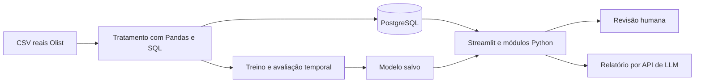

# Desenvolvimento do EntregaCerta AI

Atualizado em 05/11/2026. Este é o documento central de acompanhamento; o README explica a estrutura e a preparação.

## Problema e dados

Priorizar pedidos que merecem acompanhamento humano por risco de entrega após o dia prometido. A previsão será feita com informações disponíveis na aprovação; a demonstração será uma reprodução histórica.

Fonte: [Brazilian E-Commerce Public Dataset by Olist](https://www.kaggle.com/datasets/olistbr/brazilian-ecommerce), registros reais e anonimizados do comércio eletrônico brasileiro de 2016 a 2018. Licença publicada: CC BY-NC-SA 4.0; preservar atribuição e condições. O recebimento e o hash do ZIP estão em `recebimento_dataset.txt`. Os nove originais estão em `Dados/Brazilian Logistic/`; a consolidação está em `Dados/pedidos_consolidados.csv`.

Unidade: um pedido, agregando seus itens. Positivo: dia da entrega efetiva posterior ao dia prometido. Entrega no mesmo dia é pontual. Cancelados e casos sem desfecho não são rotulados automaticamente como pontuais; o estudo inicial se limita aos entregues elegíveis.

Usar preço/frete informado, composição do pedido, categoria, peso/dimensões, UFs e prazo/calendário quando adequados. Entrega efetiva, passagem à transportadora, status final e avaliações posteriores ficam fora da entrada do modelo. A fonte não tem versões históricas: a disponibilidade dos cadastros e da promessa na aprovação é uma hipótese a documentar.

## Arquitetura prevista



Backend em módulos Python e interface Streamlit na mesma aplicação. PyTorch entra em uma rede pequena para comparação; Scikit-learn cobre pré-processamento, referências e modelos clássicos. O modelo final será escolhido pela validação, não pela complexidade da ferramenta.

O BPMN documental já existente foi preservado em `processo.bpmn`, com prévia em `processo.png`. Ele representa o fluxo planejado; será atualizado conforme a implementação. A infraestrutura Terraform ficará para a entrega final.

## Roadmap e modo de trabalho

| Etapa | Trabalho e entrega | Estado |
|---|---|---|
| 1. Escolha | Proposta EntregaCerta e fonte Olist | Escolhidas |
| 2. Preparação simples | Estrutura, ambiente, dependências e conexão PostgreSQL | Estrutura e Pandas verificados; stack completa e conexão pendentes |
| 3. Dados e SQL | Pandas, limpeza, junções, EDA, carga PostgreSQL e divisão temporal | CSV consolidado gerado e validado; EDA completa, SQL e divisão temporal pendentes |
| 4. ML | Baselines, modelos Scikit-learn/PyTorch, avaliação e inferência salva | Não iniciada |
| 5. GenAI | Relatórios com fatos, conhecimento, API e testes de indisponibilidade | Não iniciada |
| 6. Aplicação | Interface, filtros, gráficos, previsão real, revisão e relatório | Não iniciada |
| 7. Entrega | Testes, Terraform, artigo, slides, demonstração e repositório remoto | Não iniciada |

Para implementar com orientação: **Nos guie pela etapa N, para implementarmos.** Para delegar: **Execute integralmente a etapa N.** Executar a etapa pedida e registrar arquivos, comandos, resultados e pendências, sem iniciar automaticamente a próxima.

## Regras de avaliação e confiabilidade

- Treino e avaliação usam somente dados reais. Testes técnicos isolados não são evidência de desempenho.
- Dividir pelo tempo, respeitar quando os rótulos eram conhecidos e ajustar transformações somente no treino. Reservar o teste final.
- Comparar baseline e modelos; avaliar Precision, Recall, F1, matriz de confusão, Average Precision/curva PR e qualidade da fila. Examinar falsos positivos e negativos.
- Definir a política de prioridade no desenvolvimento; os 10% inicialmente propostos são hipótese acadêmica de capacidade, não limiar empresarial comprovado.
- Mostrar probabilidade apenas se a calibração sustentar essa interpretação. Não inventar resultados, causas ou ROI.
- A LLM redige a partir dos fatos do sistema. ML e painéis continuam funcionando se a API falhar. Decisões permanecem humanas.

## Entregáveis e registro atual

### Dataset consolidado em 05/11/2026

O script `src/preparar_dados.py` gera um único CSV com **99.441 linhas e 53 colunas**, mantendo todos os pedidos originais, inclusive aqueles sem itens ou pagamentos correspondentes. Não modifica os nove CSVs de origem. O registro de execução e os hashes SHA-256 estão em `Docs/validacao_dados.txt`.

Executar na raiz do projeto:

```powershell
.\.venv\Scripts\python.exe src\preparar_dados.py
.\.venv\Scripts\python.exe -m unittest discover -s tests -v
```

Na execução de 05/11/2026, os cinco testes com registros reais passaram: preservação de pedidos/itens, reconciliação financeira com Decimal, datas originais e rótulos, pesos incompletos e distância de um pedido com vários vendedores e quantidades diferentes de itens. Os testes não são evidência de desempenho preditivo.

A consolidação usa sete fontes: pedidos, itens, pagamentos, produtos, clientes, vendedores e geolocalização. Avaliações continuam separadas para análises retrospectivas; a tradução das categorias não foi necessária porque seus nomes em português foram preservados.

| Grupo de colunas | Significado e regra |
|---|---|
| `order_*`, `customer_id` | Campos originais de pedidos; datas e status final são preservados para auditoria, não selecionados automaticamente como entradas. |
| `customer_unique_id`, `customer_city`, `customer_state`, `customer_zip_code_prefix` | Identificação anonimizada e localização do cliente; CEP é identificador de cinco dígitos. |
| `customer_latitude`, `customer_longitude` | Coordenadas aproximadas pela mediana dos pontos do prefixo de CEP; não representam o endereço exato. |
| `quantidade_itens`, `quantidade_produtos`, `quantidade_vendedores` | Número de linhas de itens, produtos distintos e vendedores distintos por pedido. Pedidos com vários vendedores são mantidos. |
| `categoria_principal`, `quantidade_categorias`, `itens_sem_categoria` | Categoria conhecida com mais itens, desempate alfabético; contagem de categorias conhecidas e de itens sem categoria. |
| `valor_itens`, `valor_frete`, `valor_pago` | Somas independentes de itens/frete e pagamentos; sem multiplicar os valores por junções entre tabelas de vários registros por pedido. |
| `peso_total_g`, `volume_total_cm3`, `itens_sem_peso`, `itens_sem_dimensoes` | Somas por item. Peso não positivo e medidas incompletas são desconhecidos para os derivados; o total fica ausente quando qualquer item não tem medida válida. |
| `uf_origem`, `quantidade_ufs_origem`, `vendedores_sem_uf`, `vendedores_ids` | UF comum aos vendedores conhecidos, `MULTIPLAS` quando há várias UFs, ou ausente se falta alguma UF. IDs separados por `\|` servem para rastreabilidade, não como entrada direta. |
| `distancia_media_vendedores_km`, `distancia_max_vendedores_km`, `vendedores_sem_distancia` | Distâncias geodésicas aproximadas por Haversine, uma contribuição por vendedor, sem ponderar pelo número de itens. Não são percursos rodoviários. Média/máximo usam as distâncias conhecidas; o contador informa a cobertura incompleta. |
| `quantidade_pagamentos`, `quantidade_formas_pagamento`, `parcelas_maximas`, `tipo_pagamento_principal` | Registros de pagamento, tipos distintos e maior número de parcelas. Tipo principal é o de maior valor total pago, com desempate alfabético. Quantidade de pagamentos não significa quantidade de parcelas. |
| `prazo_prometido_dias`, `tempo_aprovacao_horas`, `dia_semana_aprovacao`, `mes_aprovacao`, `hora_aprovacao` | Prazo em dias de calendário desde a aprovação, horas entre compra e aprovação e calendário da aprovação. Dia da semana: segunda = 0, domingo = 6. |
| `diferenca_entrega_prazo_dias`, `dias_atraso`, `atrasou`, `rotulo_disponivel` | Desfechos retrospectivos: diferença entre os dias de entrega ao cliente e promessa; atraso é essa diferença limitada a zero no mínimo. `atrasou`: 1 = atraso, 0 = pontual, vazio = sem rótulo observado válido. |
| `elegivel_modelagem`, `entrega_anterior_aprovacao`, `prazo_anterior_aprovacao` | Flags retrospectivas para seleção e auditoria. Elegibilidade inicial exige rótulo observado, aprovação conhecida e cronologia básica coerente; não substitui a avaliação de viés nem a divisão temporal. |
| `tempo_ate_despacho_dias`, `tempo_transporte_dias`, `tempo_entrega_dias` | Durações retrospectivas em dias de 24 horas, preservando frações. Durações negativas ficam indefinidas; timestamps originais permanecem disponíveis para investigar inconsistências. |

Os rótulos são calculados somente para status `delivered`, com entrega, promessa e compra conhecidas, sem entrega anterior à compra. Há **96.470 rótulos observados**, **2.971 pedidos sem rótulo** e **96.394 inicialmente elegíveis para modelagem**. As diferenças decorrem de ausência de desfecho e inconsistências cronológicas; nenhum caso recebeu data ou rótulo inferido por LLM. Pedidos sem rótulo não são negativos.

O CSV é uma **base de análise**, que também contém desfechos e campos posteriores. No treinamento futuro, usar uma seleção explícita: `COLUNAS_PREVISAO`, definida no script, contém 29 entradas candidatas; não usar todas as colunas restantes após retirar apenas o alvo. A disponibilidade de pagamentos, itens, cadastros e promessa na aprovação é uma hipótese, pois a fonte não possui snapshots históricos completos. Históricos de atraso por vendedor/rota ainda não foram calculados: precisam respeitar quando cada desfecho se tornou conhecido.

Há 775 pedidos sem itens, um sem pagamento e 1.278 com vários vendedores. Ausências não foram preenchidas por zero. Ainda faltam EDA completa, tratamento orientado à modelagem, carga PostgreSQL e divisão temporal. Não foi treinado nenhum modelo nesta tarefa.

Manter README, este documento, prompts de desenvolvimento/aplicação, BPMN editável e arquitetura. Ao final: código e dados reproduzíveis conforme licença, testes essenciais, Terraform executado, artigo PDF de até dez páginas, slides/roteiro para até vinte minutos e backup da demonstração.

Nesta reorganização foram criadas as pastas simples, consolidada a documentação e preservados o ambiente, a proveniência e o histórico anterior. Os testes da estrutura antiga não validam PostgreSQL/PyTorch nem uma aplicação futura. A cópia de segurança está na pasta vizinha `EntregaCertaAI_Anterior_884a61b`.
