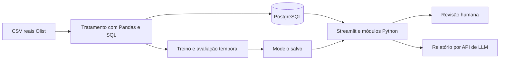

# Desenvolvimento do EntregaCerta AI

Atualizado em 30/10/2026. Este é o documento central de acompanhamento; o README explica a estrutura e a preparação.

## Problema e dados

Priorizar pedidos que merecem acompanhamento humano por risco de entrega após o dia prometido. A previsão será feita com informações disponíveis na aprovação; a demonstração será uma reprodução histórica.

Fonte: [Brazilian E-Commerce Public Dataset by Olist](https://www.kaggle.com/datasets/olistbr/brazilian-ecommerce), registros reais e anonimizados do comércio eletrônico brasileiro de 2016 a 2018. Licença publicada: CC BY-NC-SA 4.0; preservar atribuição e condições. O recebimento e o hash do ZIP estão em `recebimento_dataset.txt`. Os originais ainda não foram incorporados à pasta Dados nesta reorganização.

Unidade: um pedido, agregando seus itens. Positivo: dia da entrega efetiva posterior ao dia prometido. Entrega no mesmo dia é pontual. Cancelados e casos sem desfecho não são rotulados automaticamente como pontuais; o estudo inicial se limita aos entregues elegíveis.

Usar preço/frete informado, composição do pedido, categoria, peso/dimensões, UFs e prazo/calendário quando adequados. Entrega efetiva, passagem à transportadora, status final e avaliações posteriores ficam fora da entrada do modelo. A fonte não tem versões históricas: a disponibilidade dos cadastros e da promessa na aprovação é uma hipótese a documentar.

## Arquitetura prevista

Backend em módulos Python e interface Streamlit na mesma aplicação. PyTorch entra em uma rede pequena para comparação; Scikit-learn cobre pré-processamento, referências e modelos clássicos. O modelo final será escolhido pela validação, não pela complexidade da ferramenta.

O BPMN documental já existente foi preservado em `processo.bpmn`, com prévia em `processo.png`. Ele representa o fluxo planejado; será atualizado conforme a implementação. A infraestrutura Terraform ficará para a entrega final.

## Roadmap e modo de trabalho

| Etapa | Trabalho e entrega | Estado |
|---|---|---|
| 1. Escolha | Proposta EntregaCerta e fonte Olist | Escolhidas |
| 2. Preparação simples | Estrutura, ambiente, dependências e conexão PostgreSQL | Estrutura pronta; instalação da nova stack e conexão pendentes |
| 3. Dados e SQL | Pandas, limpeza, junções, EDA, carga PostgreSQL e divisão temporal | Não iniciada |
| 4. ML | Baselines, modelos Scikit-learn/PyTorch, avaliação e inferência salva | Não iniciada |
| 5. GenAI | Relatórios com fatos, conhecimento, API e testes de indisponibilidade | Não iniciada |
| 6. Aplicação | Interface, filtros, gráficos, previsão real, revisão e relatório | Não iniciada |
| 7. Entrega | Testes, Terraform, artigo, slides, demonstração e repositório remoto | Não iniciada |

Para implementar com orientação: **Nos guie pela etapa N, para implementarmos.** Para delegar: **Execute integralmente a etapa N.** Executar a etapa pedida e registrar arquivos, comandos, resultados e pendências, sem iniciar automaticamente a próxima.

## Regras de avaliação e confiabilidade

- Treino e avaliação usam somente dados reais. Testes técnicos isolados não são evidência de desempenho.
- Dividir pelo tempo, respeitar quando os rótulos eram conhecidos e ajustar transformações somente no treino. Reservar o teste final.
- Comparar baseline e modelos; avaliar Precision, Recall, F1, matriz de confusão, Average Precision/curva PR e qualidade da fila. Examinar falsos positivos e negativos.
- Definir a política de prioridade no desenvolvimento; os 10% inicialmente propostos são hipótese acadêmica de capacidade, não limiar empresarial comprovado.
- Mostrar probabilidade apenas se a calibração sustentar essa interpretação. Não inventar resultados, causas ou ROI.
- A LLM redige a partir dos fatos do sistema. ML e painéis continuam funcionando se a API falhar. Decisões permanecem humanas.

## Entregáveis e registro atual

Manter README, este documento, prompts de desenvolvimento/aplicação, BPMN editável e arquitetura. Ao final: código e dados reproduzíveis conforme licença, testes essenciais, Terraform executado, artigo PDF de até dez páginas, slides/roteiro para até vinte minutos e backup da demonstração.

Nesta reorganização foram criadas as pastas simples, consolidada a documentação e preservados o ambiente, a proveniência e o histórico anterior. Os testes da estrutura antiga não validam PostgreSQL/PyTorch nem uma aplicação futura. A cópia de segurança está na pasta vizinha `EntregaCertaAI_Anterior_884a61b`.
