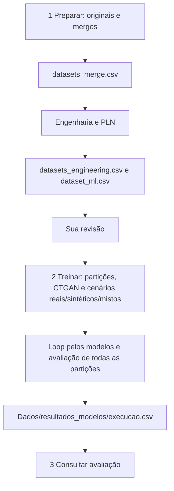

# Fluxo novo: seus dados, sua validação

## Os nove arquivos do pipeline

| Arquivo | Função |
|---|---|
| `src/1_preparar_dados.py` | Execute primeiro: merge, engenharia, PLN e os três CSVs. |
| `src/1_pln.py` | Auxiliar automático: classifica comentários para preencher atrasos ausentes. |
| `src/2_dados_treino.py` | Auxiliar automático: contrato de colunas, validação e divisão temporal. |
| `src/2_ctgan.py` | Auxiliar automático: ajusta CTGAN no treino real e gera sintéticos. |
| `src/2_catalogo_modelos.py` | Auxiliar automático: famílias de classificadores e regressores disponíveis. |
| `src/2_treinar_modelos.py` | Execute após revisar: gera cenários, treina em loop e salva o CSV de métricas. |
| `src/3_avaliar_modelos.py` | Execute por último: consulta o CSV da rodada concluída, sem novo treino. |
| `src/configuracoes/1_dados.json` | Fontes, saída, transportadoras e semente da PLN. |
| `src/configuracoes/2_treinamento.json` | Modelos, CTGAN, proporções, cortes e confirmação da revisão dos dados. |

Só os três scripts de execução precisam ser chamados manualmente. Os prefixos
1 e 2 dos auxiliares indicam a etapa à qual pertencem. Para uma rodada mais curta,
ajuste épocas, quantidades e modelos no mesmo JSON de treinamento.



Web, assistente, PostgreSQL, relatórios e EDA conservam seus módulos próprios e
não entram nessa contagem. Os atalhos de dados em `main.py` usam os novos scripts;
os comandos da aplicação web continuam disponíveis.

## 1. Criar os CSVs

Na raiz, use um ambiente com as dependências do projeto. Neste computador:

```powershell
.\.venv-pipeline\Scripts\python.exe src/1_preparar_dados.py
```

Configuração desta etapa: `src/configuracoes/1_dados.json`.

| Arquivo | Conteúdo |
|---|---|
| `Dados/datasets_merge.csv` | Uma linha por pedido com exatamente um vendedor, contendo os campos selecionados dos originais. |
| `Dados/datasets_engineering.csv` | Features, estatísticas dos vendedores e regra de preenchimento/exclusão pela PLN. |
| `Dados/dataset_ml.csv` | Atributos solicitados, dois alvos e metadados, incluindo a partição temporal. |
| `Dados/datasets_preparacao.json` | Contagens, ausências e convenções usadas, para você conferir. |

Entram pedidos com exatamente um vendedor. Para `delay_status` ausente, a PLN
legada (TF-IDF + regressão logística) lê os comentários: mantém como 1 os
classificados como atrasados e descarta os demais pedidos sem rótulo. Classes
já conhecidas são preservadas. `delay_in_days` desconhecido continua vazio.
As outras ausências permanecem para seu tratamento; não há imputação de atributos.

Se `datasets_engineering.csv` já existe, a preparação o reutiliza, preservando
seu tratamento e recalculando as features de calendário pelas datas originais.
O [contrato de calendário](../src/README.md#calendário-da-entrega-à-transportadora)
detalha os dias úteis, feriados, encoder e o comando `--somente-calendario`, que
atualiza apenas essas colunas nos CSVs existentes. Antes de atualizar os CSVs, guarda a versão anterior em
`Dados/experimentos/antes_preparacao_<data>/`. Para reconstruir dos originais,
configure uma pasta de saída nova em `1_dados.json`.

### Como os merges evitam multiplicação

As fontes são lidas apenas com as colunas solicitadas e as chaves necessárias às
junções. `order_id`, `product_id`, `seller_id` e `order_item_id` são usados para
relacionar/ordenar itens; `order_item_id` não precisa ficar no CSV final.

- Produtos de cada pedido ficam em listas JSON alinhadas em `datasets_merge.csv`,
  preservando cada item, inclusive compras repetidas do mesmo produto.
- `price` e `freight_value` são somas dos itens, uma vez por item.
- `payment_value` é a soma dos pagamentos; `payment_sequential` é a maior sequência
  registrada; `payment_installments` é o maior número de parcelas.
- `review_score` é a média das avaliações do pedido; títulos e mensagens ficam
  em listas JSON, sem cortar texto ou escolher arbitrariamente uma avaliação.
- Geolocation é resumida pela média das coordenadas de cada CEP, sem filtros;
  no merge os campos recebem os sufixos `_customer` e `_seller`.
- Campos ausentes permanecem ausentes; totais de peso/volume incompletos ficam
  vazios em vez de aparentar um total conhecido.

### Engenharia

| Coluna | Cálculo |
|---|---|
| `qtd_items` | Número de itens do pedido, incluindo produtos repetidos. |
| `total_volume_cm3` | Soma de comprimento × altura × largura de cada item. |
| `total_weight` | Soma dos pesos de cada item, em gramas. |
| `customer_lat`, `customer_lng`, `seller_lat`, `seller_lng` | Coordenadas médias dos respectivos CEPs. |
| `predominant_product_category_name` | Categoria mais frequente nos itens; empate em ordem alfabética. |
| `distance_customer_seller` | Haversine entre cliente e único vendedor, em km; não é percurso rodoviário. |
| `order_delivered_carrier_date_in_days` | Despacho menos compra, em dias de 24 horas. |
| `order_delivered_customer_date_in_days` | Entrega menos compra, em dias de 24 horas. |
| `order_estimated_delivery_date_in_days` | Prazo prometido menos compra, em dias de 24 horas. |
| `order_purchase_timestamp_in_days` | Compra menos o primeiro timestamp de compra da base; origem registrada no JSON. |
| `approval_date_in_days` | Aprovação menos compra, em dias de 24 horas. |
| `delay_in_days` | Entrega em dias menos prazo em dias; negativos significam antecipação. |
| `delay_status` | `delay_in_days >= 1`; ausente quando a diferença é desconhecida. |
| `seller_review_score_mean` | Média global de todas as notas associadas ao vendedor, calculada uma vez. |
| `seller_sales_count` | Quantidade global de pedidos distintos associados ao vendedor. |
| `seller_reviews_count` | Quantidade de avaliações com nota usadas na média. |
| `seller_reliability_score` | `round(nota_media * 0.6 + (vendas / max_vendas) * 5 * 0.4, 2)`; nota ausente permanece ausente. |
| `transportadora` | Atribuição pseudoaleatória por ID do pedido e semente; quantidade em `1_dados.json`. |

As transportadoras são fictícias, chamadas `transportadora_1`, etc.; a mesma
semente e quantidade produzem a mesma atribuição, mesmo reordenando os pedidos.
O score normaliza pelas vendas máximas entre os vendedores presentes no engineering.

As diferenças são calculadas em segundos e divididas por 86.400, preservando
frações de dia para você decidir o arredondamento no tratamento. Não se truncam antecipações em zero. `order_approved_at` permanece para a divisão temporal. As demais datas,
CEPs e colunas individuais de produto listadas para remoção são retiradas do
engineering; `product_weight_g` é o nome original correspondente a product_weight.

As estatísticas do vendedor usam a base original inteira, inclusive vendas que
não entram no filtro de um vendedor. Avaliações de um pedido com vários
vendedores são associadas a cada vendedor desse pedido, sem ponderar pelo número
de itens. Não há atualização progressiva, suavização ou nota neutra.

A média global pode incluir o próprio pedido e avaliações futuras. Portanto, a
comparação com essa feature é **retrospectiva**, não comprova previsão do atraso
na aprovação. A nota própria e comentários permanecem no CSV para sua análise,
mas o modelo usa o score composto do vendedor. O `order_status` final também
entra em X conforme solicitado; essa avaliação continua sendo retrospectiva.

## 2. Seu tratamento e a CTGAN

Você revisa/trata `Dados/datasets_engineering.csv`, executa `preparar-dados` para
atualizar `dataset_ml.csv` e confere as ausências deste último. Depois, em
`src/configuracoes/2_treinamento.json`, altere **`dados_validados` para `true`**.
O código não fará essa alteração por você. Enquanto estiver `false`, geração e
treinamento ficam bloqueados, em todas as execuções.

```powershell
.\.venv-pipeline\Scripts\python.exe src/2_treinar_modelos.py --etapa preparar --nome estudo_01
```

Essa etapa verifica tipos, ausências, IDs e consistência entre os dois alvos.
Se houver problema, informa o erro; não preenche valores. A opção explícita
`excluir_sem_data_transportadora: true`, quando o treino inclui features de calendário,
seleciona os pedidos com data de despacho conhecida e registra quantos ficaram de
fora. Os CSVs de entrada são preservados. Sem essa opção, ausências continuam
bloqueando o treino; nenhuma outra exclusão é feita pelo carregamento.
O engineering e o CSV de ML recebem `particao`, definida somente pela aprovação
com os cortes de `2_treinamento.json`:

- **Treino:** aprovação antes de 01/01/2018.
- **Validação:** aprovação de 01/01/2018 até antes de 01/05/2018.
- **Teste:** aprovação a partir de 01/05/2018.

Nenhum pedido é excluído pela data de entrega ou de disponibilidade do rótulo.
Essa comparação é retrospectiva: os desfechos já conhecidos são usados para avaliar
os modelos, sem simular quais rótulos estariam disponíveis em cada corte histórico.
A CTGAN continua sendo ajustada somente no treino real.

Para atualizar apenas a partição nos CSVs que você já tratou:

```powershell
.\.venv-pipeline\Scripts\python.exe src/1_preparar_dados.py --somente-particoes
```

Esse comando preserva suas linhas e valores e guarda uma cópia antes de atualizar.
Após alterar os cortes, execute-o novamente. O treino usa os mesmos cortes.
`1_dados.json` aceita `configuracao_treino` para indicar outro JSON de treinamento.
Use um novo `--nome` depois de alterar os CSVs de uma execução anterior.

A CTGAN recebe os atributos de `dataset_ml.csv` e `delay_in_days`; a classe
sintética é derivada pela mesma regra `>= 1` quando os dias são conhecidos.
Para atrasos inferidos pela PLN, uma coluna técnica discreta registra ausência
dos dias: o zero usado internamente como sentinela é restaurado como vazio após
a geração, com classe 1. Nenhuma duração é inventada. Não aplica o antigo logaritmo,
imputação, limites por quantis ou correções de peso/distância. Há codificação
categórica necessária à biblioteca; amostras geradas podem exigir inspeção de
plausibilidade. Identificação e origem de cada amostra ficam nos CSVs.

## 3. Treinar e avaliar

```powershell
.\.venv-pipeline\Scripts\python.exe src/2_treinar_modelos.py --nome estudo_01
.\.venv-pipeline\Scripts\python.exe src/3_avaliar_modelos.py --nome estudo_01
```

O treino reutiliza a preparação dessa execução. Com outro nome ainda inexistente,
`treinar` pode executar geração e treino juntos, sempre exigindo sua validação.
Configuração e hashes dos CSVs são conferidos ao retomar; alterações exigem outra
execução. Os modelos fazem somente escala numérica e codificação categórica,
aprendidas no treino, sem imputação ou seleção automática de linhas.

Mantidos: modelos configuráveis; cenários reais, sintéticos e mistos; avaliações
em treino, validação e teste; segmentos real/sintético/total; teste real comum;
CSV de previsões, matriz de confusão e métricas por cenário e modelo.
As métricas e as quatro células da matriz (`tn`, `fp`, `fn`, `tp`) ficam juntas
em **um CSV por execução**, diretamente em `Dados/resultados_modelos/`, sem
subpastas. Cada linha identifica cenário, modelo, partição e segmento. As colunas
`melhor_classificador_validacao` e `melhor_regressor_validacao` registram a seleção.

Classificação: F1, precision, recall, accuracy, AP, ROC AUC e Brier. Regressão:
MAE, RMSE, R² e viés sobre a diferença assinada em dias, incluindo antecipações.
Métricas de fila somam apenas atrasos positivos, para uma entrega antecipada não
cancelar os dias de atraso de outra. São dias identificados, não dias evitados.
Limiar e seleção de modelos usam validação, não teste.
Classificação inclui os rótulos inferidos, contados em `rotulos_pln`; as métricas
de regressão e os totais de dias usam somente durações conhecidas e informam as
contagens de ausências. O regressor treina apenas com dias conhecidos; sem esses
exemplos, fica ausente e suas métricas vazias. Os rótulos PLN são estimativas,
e a avaliação da própria PLN usa rótulos das expressões do legado.

## Onde ajustar e encontrar resultados

| Local | Função |
|---|---|
| `src/configuracoes/1_dados.json` | Fontes, saída, quantidade/semente das transportadoras e semente da PLN. |
| `src/configuracoes/2_treinamento.json` | Validação manual, entrada, atributos, modelos, CTGAN, cenários e cortes. |
| `Dados/comparacao_modelos/<execucao>/` | Pools e CSVs de cada cenário/partição. |
| `Modelos/comparacao_modelos/<execucao>/` | Gerador, modelos `<cenario>__<modelo>.joblib`, configurações e `previsoes.csv`. |
| `Dados/resultados_modelos/<execucao>.csv` | Todas as métricas, matrizes e seleção da rodada, sem subpastas. |
| `Modelos/experimentos/resultados_anteriores/<execucao>/` | Estrutura antiga arquivada, incluindo os modelos e previsões antigos. |
| `lixeira/` | Pipeline e estudos antigos arquivados; dependências ainda usadas pela web continuam em `src`. |

Os 13 atributos são: `order_status`, `price`, `freight_value`, `customer_state`,
`seller_state`, `qtd_items`, `total_volume_cm3`, `total_weight`,
`predominant_product_category_name`, `distance_customer_seller`,
`seller_reliability_score`, `transportadora` e `approval_date_in_days`.
`delay_status` e `delay_in_days` são alvos, nunca atributos de entrada.
`order_id`, `order_approved_at`, `delay_status_source`, `label_available_at` e `particao`
são metadados no CSV, excluídos de X. A disponibilidade usa a entrega observada
ou a data da resposta à avaliação usada pela PLN.

A aplicação web mantém o modelo e o esquema de banco anteriores enquanto você
valida o fluxo novo. O comparador não publica automaticamente modelos nem altera
PostgreSQL; nenhum treino novo de CTGAN ou dos modelos de atraso foi executado nesta adaptação.
Os cinco CSVs históricos migrados trazem `versao_dados` indicando que antecedem
o novo `dataset_ml.csv`. A preparação ajusta apenas a PLN legada; CTGAN e modelos
de atraso aguardam `dados_validados=true`.
