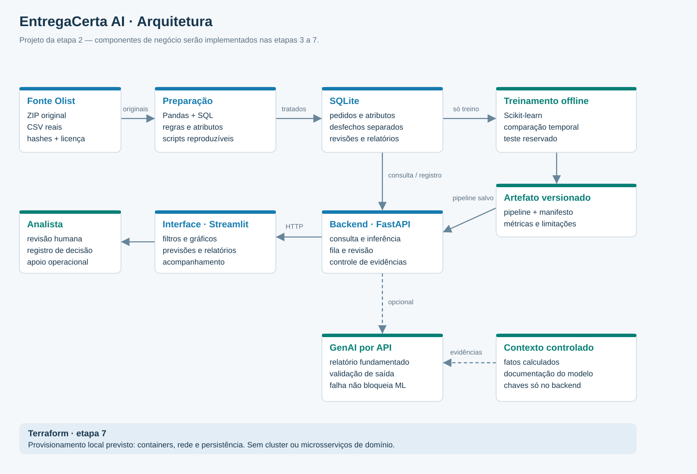

# Arquitetura e interfaces planejadas

Versão 1.0 · etapa 2. Os componentes de negócio descritos aqui ainda serão implementados.



Código editável: [Mermaid](diagramas/arquitetura.mmd); geração SVG: `scripts/build_diagrams.py`.

## Componentes e fronteiras

| Módulo previsto em `src/entregacerta/` | Entrada → saída | Responsabilidade e etapa |
|---|---|---|
| `data/` | ZIP/CSV + manifesto → tabelas limpas e relatório | Pandas, integridade, elegibilidade e atributos; etapa 3 |
| `storage/` | tabelas/consultas → SQLite | Chaves, transações e consultas parametrizadas; etapa 3 e registros operacionais na 6 |
| `training/` | atributos + alvo + protocolo → pipeline, métricas, ficha | Execução offline reproduzível; etapa 4 |
| `inference/` | atributos aprovados + versão → escore e evidências | Carregar artefato confiável, conferir contrato, não consultar desfecho; etapa 4 |
| `genai/` | pacote factual + conhecimento → relatório validado | API opcional, timeout, validação e resumo factual; etapa 5 |
| `api/` | HTTP validado → JSON | FastAPI, acesso ao banco e orquestração; etapa 6 |
| `frontend/` | JSON da API → tela/ações | Streamlit e Plotly, filtros, fila e relatório; etapa 6 |
| `settings.py`, `cli.py` | configuração → diagnóstico | Já implementados e testáveis na etapa 2 |

Uma aplicação modular com dois processos locais (API e interface), um banco SQLite e treinamento offline. A separação torna backend e frontend verificáveis e evita lógica de modelo duplicada na interface. Não exige microsserviços nem agentes. A interface acessa o backend por HTTP; não lê diretamente o SQLite nem recebe a chave da LLM.

## Contrato HTTP para implementar na etapa 6

Prefixo `/api/v1`; estes caminhos **não estão ativos nesta etapa**.

| Método/caminho | Entrada | Resposta e regra |
|---|---|---|
| `GET /health` | nenhuma | Versões e disponibilidade de banco/modelo/GenAI, sem segredos |
| `GET /orders` | período de aprovação, UF, paginação | Pedidos reais, cobertura e filtros aplicados |
| `GET /indicators` | mesmos filtros e coorte | Contagens e indicadores com denominador e período |
| `GET /orders/{order_id}` | ID existente | Blocos separados de atributos na aprovação e desfecho posterior |
| `POST /predictions` | `order_id`, `model_version` | `prediction_id`, escore, tipo do escore, contrato, versão e snapshot dos atributos |
| `GET /queue` | dia/lote e capacidade permitida | Ordenação, K, política e contexto de reprodução histórica |
| `POST /reviews` | `prediction_id`, decisão, nota limitada | Registro humano persistido com data de criação real |
| `POST /reports` | `prediction_id`, `review_id` opcional | modo `llm` ou `factual_fallback`, evidências, texto e aviso de revisão |

Não aceitar colunas arbitrárias nem SQL do usuário. No MVP, a inferência consulta um pedido real por ID, evitando entrada manual incoerente e desfechos injetados. Erros previstos: 404 para registro desconhecido; 422 para dados inválidos; 409 para incompatibilidade de contrato/modelo; 503 para banco/modelo indisponível. Falha de GenAI retorna resumo factual identificado, mantendo a previsão. Limites de notas, paginação, tempo e tamanho de contexto serão implementados e testados.

## Fluxo e persistência

Fonte imutável → aquisição com hashes → Pandas e SQL → atributos separados de desfechos → treinamento temporal → pipeline salvo → API → tela → revisão humana → relatório. Inferência consulta somente atributos permitidos. Desfechos servem ao treinamento/avaliação e à comparação histórica em bloco distinto. Não alimentar a LLM com desfecho futuro para explicar a previsão original.

Salvar no registro de previsão versão/hash do modelo, versão dos atributos, snapshot de entrada e política. Registrar notas e relatórios criados na demonstração como registros da demonstração, sem tratá-los como intervenções históricas da Olist. O modelo não é retreinado ao abrir a página.

## Organização prevista

```text
config/                 contratos, estágios e proveniência
data/raw/               originais imutáveis, ignorados pelo Git
data/processed/         derivados, splits e SQLite, ignorados
artifacts/              pipeline, métricas e manifestos da etapa 4
src/entregacerta/        módulos acima; somente settings/CLI existem agora
scripts/                preparação, treino e operação conforme as etapas
tests/                  verificações essenciais
prompts/development/    pedidos e decisões do desenvolvimento assistido
prompts/application/    prompts da GenAI na etapa 5
docs/                   decisões, BPMN, arquitetura, avaliações e entregas
infra/terraform/        infraestrutura efetiva na etapa 7
```

Diretórios futuros não representam funcionalidades existentes. Evitar arquivos vazios que simulem módulos prontos.

## Segurança e implantação

Execução local inicialmente, com API em `127.0.0.1:8000` e interface em `127.0.0.1:8502` (8501 já foi usado por outro protótipo). SQLite com um backend escritor, transações curtas e chaves estrangeiras habilitadas. Se a concorrência exigir, reavaliar banco; não introduzir PostgreSQL antecipadamente.

`.env` local contém caminhos e credenciais; `.env.example` contém campos vazios. Nunca versionar chave, banco, dados brutos ou estado Terraform. Não publicar o protótipo sem decidir autenticação, TLS, limites de acesso e retenção. Não usar hashes de cliente como prova de impossibilidade de reidentificação. Reduzir geografia a UF e não enviar IDs de cliente ou texto livre da fonte ao provedor. Registrar apenas metadados necessários dos erros. Carregar artefatos joblib somente produzidos pelo pipeline confiável, nunca uploads arbitrários.

Terraform é obrigatório pelo requisito adicional. Caminho planejado: provider Docker, rede privada da aplicação, containers de backend/frontend e volume do SQLite montado apenas no backend. Frontend e API acessíveis apenas nas portas locais necessárias; chave por configuração local, sem colocá-la em valores versionados ou outputs. Custos de nuvem não são necessários. `terraform init/validate/plan/apply` e verificação da persistência pertencem à etapa 7. Docker client instalado não comprova Engine funcionando.

Referências técnicas consultadas: [FastAPI](https://fastapi.tiangolo.com/), [Python venv](https://docs.python.org/3.12/library/venv.html), [provider Docker para Terraform](https://registry.terraform.io/providers/kreuzwerker/docker/latest/docs). As versões instaladas estão em `requirements.lock`; compatibilidade será reavaliada quando os módulos forem implementados.
