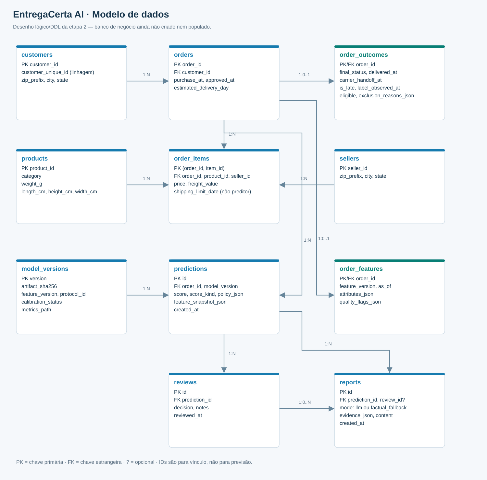

# Modelo de dados planejado

Etapa 2: desenho e validação técnica em SQLite **em memória, sem registros**. A carga de dados reais será feita na etapa 3. O SQL está em [schema_planejado.sql](schema_planejado.sql).

Fontes editáveis: [Mermaid](diagramas/modelo_dados.mmd) e `scripts/build_diagrams.py` para o SVG detalhado.

| Tabela | Grão/chave | Conteúdo e uso |
|---|---|---|
| `customers` | customer_id | Cadastro original, UF; `customer_unique_id` só para rastreabilidade |
| `sellers` | seller_id | Cadastro original e UF; sem taxa histórica de atraso no MVP |
| `products` | product_id | Categoria, peso e dimensões; inválidos preservados na fonte e tratados no derivado |
| `orders` | order_id | Cliente, compra, aprovação e dia prometido; dados de referência na decisão |
| `order_items` | (order_id,item_id) | Produto, vendedor, preço e frete por linha; prazo de expedição preservado para auditoria, proibido como atributo inicial |
| `order_outcomes` | order_id, 0..1 por pedido | Status final, datas posteriores, alvo, elegibilidade e motivos de exclusão; acesso separado da inferência |
| `order_features` | order_id, 0..1 por pedido | Um contrato ativo, instante as_of, JSON com os 19 atributos e flags de qualidade |
| `model_versions` | version | Hash do artefato, contrato, protocolo, calibração e caminho relativo das métricas |
| `predictions` | id | Referências a pedido/modelo, escore, política, snapshot da entrada e data real da execução |
| `reviews` | id | Referência à previsão, decisão e nota humana limitada |
| `reports` | id | Evidências, modo LLM/fallback, conteúdo e revisão opcional |

Customer 1:N orders; order 1:N items; product/seller 1:N items; order 0..1 outcomes/features; order/model 1:N predictions; prediction 1:N reviews/reports; review 0:N reports. Algumas relações são opcionais antes da carga/execução. Pedidos sem itens serão sinalizados, não fabricados. `customer_id` não equivale a pessoa única. Agregar itens antes de juntar desfechos evita multiplicar pedidos.

Datas são ISO 8601 em TEXT, preservando a semântica da fonte. Valores monetários originais serão reconciliados e arredondados de forma explícita; REAL é suficiente para análise acadêmica, não um livro contábil. Prefixos de CEP ficam em TEXT para preservar zeros, mas não entram no modelo inicial nem na LLM.

`attributes_json` facilita versionar o primeiro contrato sem dezenas de colunas operacionais; os pipelines Pandas expandirão colunas tipadas e consultas poderão usar `json_extract`. O banco validará JSON e relações; a aplicação validará allowlist, tipos, intervalos e ausência de informações futuras. O uso de JSON não dispensa esses testes. Antes de outra versão de atributos, exportar o snapshot/manifesto anterior; cada previsão já conserva a entrada exata.

A etapa 3 implementará a carga de `customers/sellers/products/orders/items/outcomes/features`. As tabelas operacionais serão usadas depois do modelo. Sem reviews e pagamentos da fonte no MVP, pois não são necessários para a decisão escolhida. A presença de nove CSVs no ZIP não obriga usar todos.

Ao salvar relatório, a aplicação deverá verificar que o review opcional pertence à mesma previsão; as duas FKs sozinhas não asseguram essa regra. Datas de criação da demonstração não substituem datas históricas. Nenhum texto gerado será fonte de rótulo para treinar o modelo.
